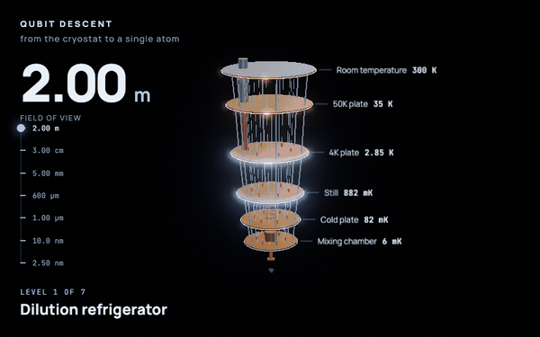
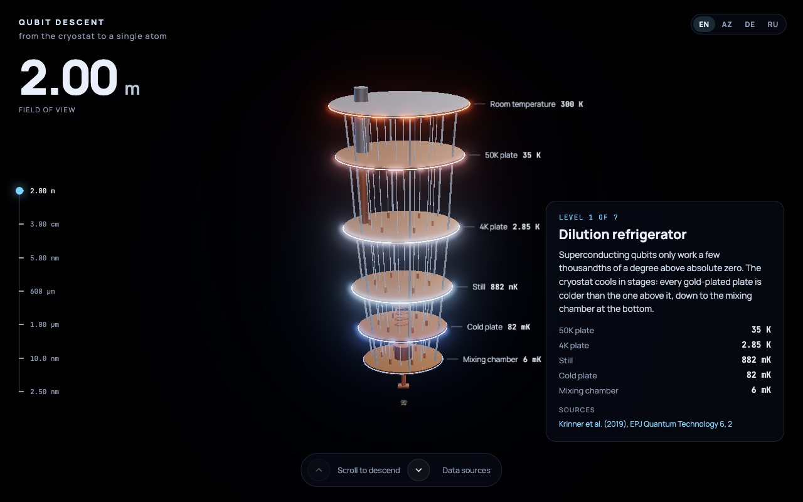
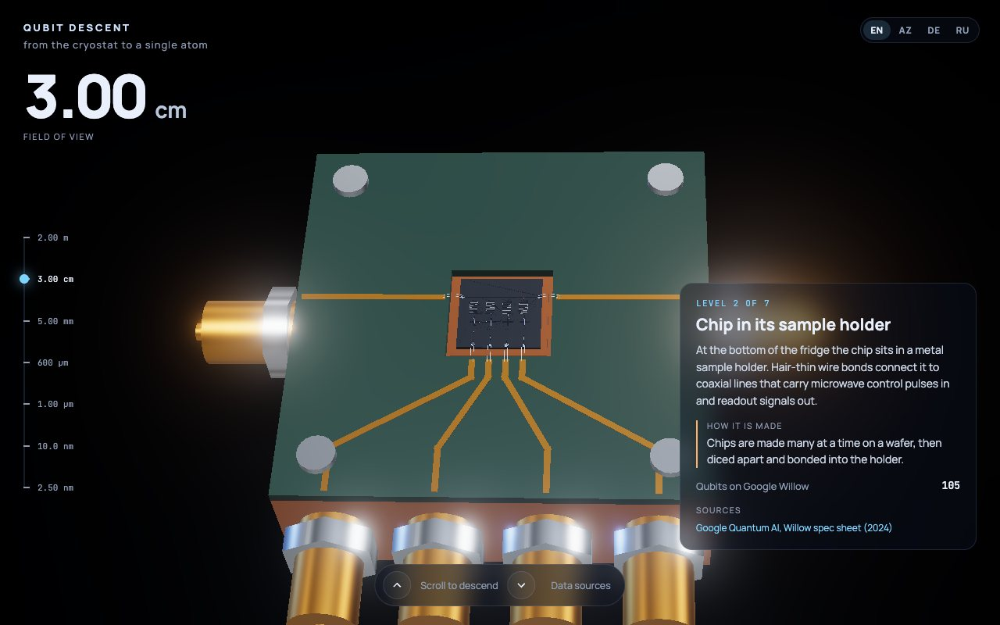
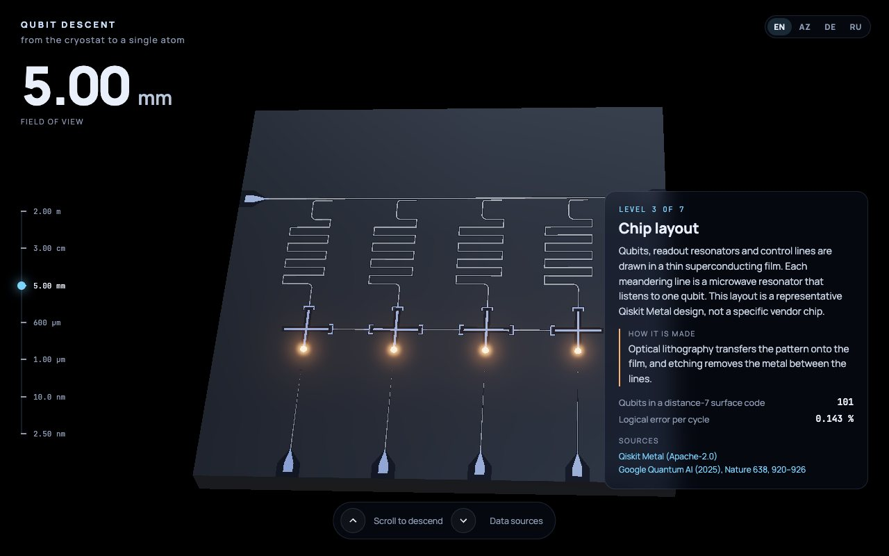
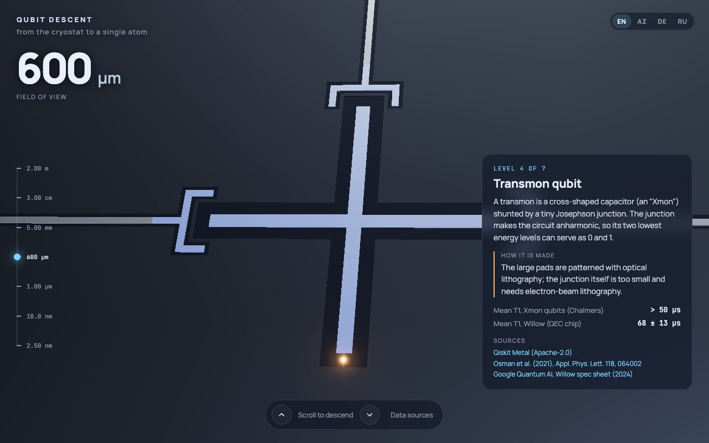
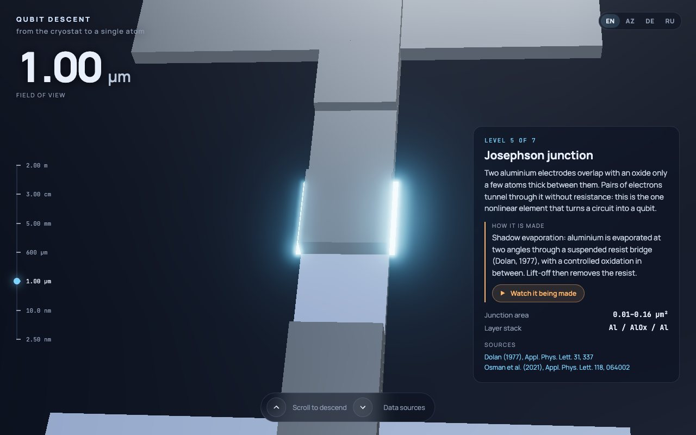
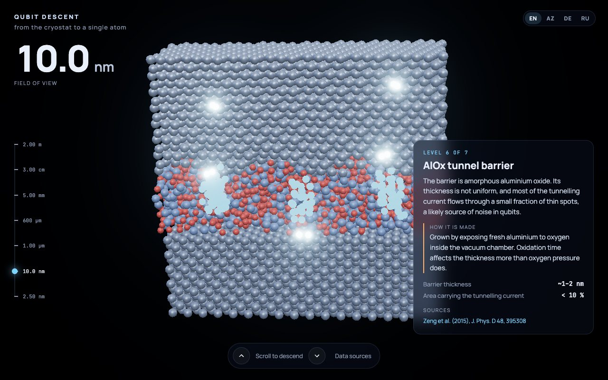
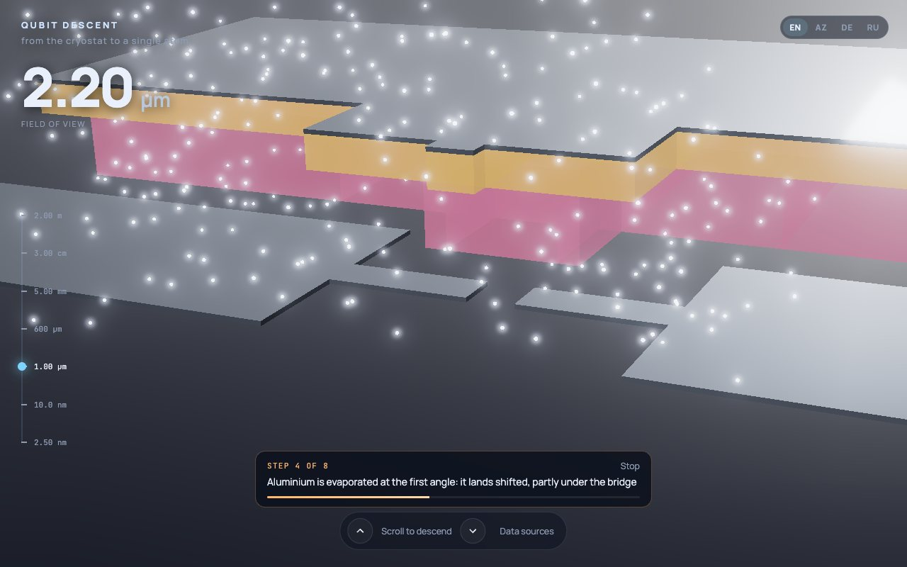
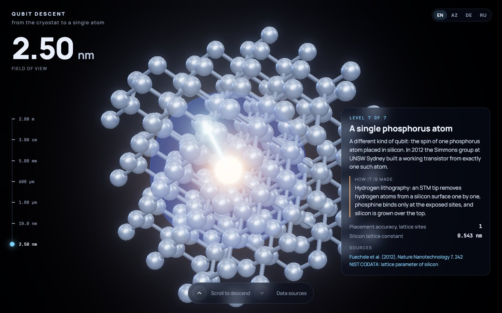
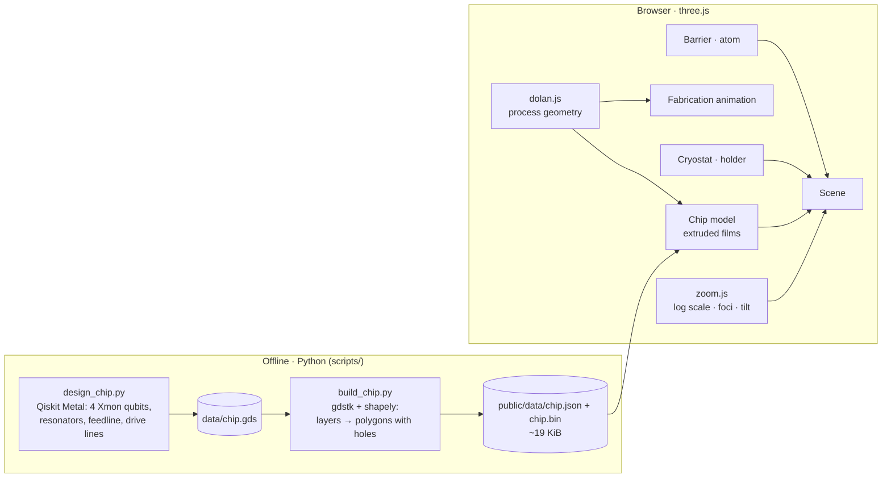

<div align="center">

# ⚛️ Qubit Descent: a journey into a quantum computer

**One continuous zoom, nine orders of magnitude: from a 2-metre dilution refrigerator down to a single atom.**
On every level: what the part is, how it is *made*, and where each number comes from.

[](https://elkhan-isayev.github.io/qubit-descent/)

[](https://github.com/Elkhan-Isayev/qubit-descent/actions/workflows/deploy.yml)




<sub>Higher quality: <a href="docs/qubit-descent.mp4">docs/qubit-descent.mp4</a></sub>

</div>

---

## ✨ Highlights

- **A real chip, not a drawing.** The chip and qubit levels are a 4-qubit Xmon chip designed with IBM's open-source [Qiskit Metal](https://github.com/qiskit-community/qiskit-metal), exported to a GDS mask and turned into 3D in the browser: readout resonators on a feedline, bus couplers, drive lines, wire-bond pads.
- **One continuous zoom.** Scrolling flies from the cryostat into the sample holder, onto the chip, into one qubit, its Josephson junction and the tunnel barrier inside it. Each level's model already contains the next one at the right spot, so there are no cuts.
- **How it is made.** Every level says how that part is manufactured, and level 5 *shows* it: an 8-step animation of the Dolan-bridge process (resist bilayer, electron-beam writing, undercut, aluminium evaporated at two angles, oxidation, lift-off) on the qubit's own junction. The animation ends in exactly the junction you see on the level, ghost copies included.
- **Every number has a source.** Stage temperatures, qubit counts, coherence times, junction area, barrier thickness: each figure on screen links to its paper or specification ([docs/DATA_SOURCES.md](docs/DATA_SOURCES.md)). What could not be sourced is not shown.
- **Down to atoms.** The AlOx barrier is drawn atom by atom: crystalline aluminium electrodes, an amorphous oxide 1–2 nm thick, and the thin spots that carry the tunnelling current. The final level is a phosphorus donor in a silicon lattice, a qubit that is literally one atom.
- **Four languages.** English, Azərbaycanca, Deutsch and Русский, switchable on the fly. The choice is remembered and shareable via `?lang=`.
- **Desktop and phone.** Scroll, swipe, arrow keys or the scale ruler; the layout adapts to portrait screens.

## 🖼 Gallery

| | |
|:---:|:---:|
|  |  |
| **1 · Dilution refrigerator, 2 m.** Stages from 300 K down to 6 mK | **2 · Sample holder, 3 cm.** The chip, wire bonds, coaxial connectors |
|  |  |
| **3 · Chip, 5 mm.** Four Xmon qubits designed in Qiskit Metal | **4 · Transmon, 600 µm.** One cross-shaped qubit and its junction |
|  |  |
| **5 · Josephson junction, 1 µm.** Al / AlOx / Al, 0.04 µm² overlap | **6 · Tunnel barrier, 10 nm.** Amorphous AlOx, hot spots glowing |
|  |  |
| **How a junction is made.** Aluminium evaporated at an angle through a resist bridge | **7 · One atom, 2.5 nm.** A phosphorus donor in silicon and its spin |

## 🔭 The seven levels

| # | Field of view | Level | How it is made | Key sources |
|---|---|---|---|---|
| 1 | 2 m | Dilution refrigerator: 300 K → 35 K → 2.85 K → 882 mK → 82 mK → 6 mK | — | Krinner et al. 2019 |
| 2 | 3 cm | Chip in its sample holder | Wafer → dicing → wire bonding | Google Willow spec sheet |
| 3 | 5 mm | Chip layout | Optical lithography + etching | Qiskit Metal; Google Quantum AI 2025 |
| 4 | 600 µm | Transmon qubit | Optical + electron-beam lithography | Osman et al. 2021; Willow spec sheet |
| 5 | 1 µm | Josephson junction | Shadow evaporation through a Dolan bridge (animated) | Dolan 1977; Osman et al. 2021 |
| 6 | 10 nm | AlOx tunnel barrier | Controlled oxidation | Zeng et al. 2015 |
| 7 | 2.5 nm | Phosphorus atom in silicon | Hydrogen lithography with an STM tip | Fuechsle et al. 2012; NIST |

## 🚀 Getting started

```bash
git clone https://github.com/Elkhan-Isayev/qubit-descent.git
cd qubit-descent
npm install
npm run dev          # http://localhost:5173
```

```bash
npm run build        # production build into dist/
npm run preview      # serve the build locally
```

Every push and pull request runs the test suites. Only when **all tests pass** does [`.github/workflows/deploy.yml`](.github/workflows/deploy.yml) build the site and deploy `main` to **GitHub Pages**.

**Requirements:** a WebGL 2 browser (Chrome, Edge, Firefox, Safari 15+). The whole app is about 175 KB gzipped, three.js and the chip data included.

## 🎮 Controls

| Input | Action |
|---|---|
| Scroll / swipe | descend and ascend continuously |
| <kbd>↓</kbd> <kbd>↑</kbd>, <kbd>PgDn</kbd> <kbd>PgUp</kbd>, <kbd>Space</kbd> | next / previous level |
| <kbd>Home</kbd> <kbd>End</kbd> | first / last level |
| Scale ruler | jump to a level |
| ▶ *Watch it being made* (level 5) | play the junction fabrication (also plays once on first arrival) |
| `EN · AZ · DE · RU` | interface language (also `?lang=az` etc.) |

## 🧪 Tests

```bash
npm test             # JavaScript unit tests (Vitest + jsdom)
npm run test:py      # Python pipeline tests (pytest, needs .venv-metal)
npm run test:all     # both
```

| Suite | Covers |
|---|---|
| `tests/js/zoom` | log-scale span ↔ progress, level stepping, cross-fades, zoom-to-point foci in 3D, view tilt |
| `tests/js/levels` | stage spacing and temperatures from the source table, bond pads, junction area in the published range, barrier thickness 1–2 nm with < 10 % hot area, fcc lattice |
| `tests/js/fabrication` | Dolan geometry (shift = h·tan θ, undercut, 0.04 µm² overlap, film stacking, ghost copies), animation timeline, e-beam path |
| `tests/js/lattice` | silicon diamond lattice and its tetrahedral bonds |
| `tests/js/data` | chip binary format, ring orientation, vertex accounting, error handling |
| `tests/js/i18n` | all 4 languages complete (UI, levels, facts, fabrication captions), every level cites a known source, formatting, persistence |
| `tests/python/*` | GDS → polygons in µm for any GDS unit, union of keyholed strips into real holes, ring clean-up, chip layers and qubits, committed web data up to date |

## 🔬 How it works



- **Zoom engine.** Scroll progress maps to a field of view on a log scale, with each level getting the same scroll distance. Every model is drawn in its own units (mm, µm, nm) and rescaled each frame, so precision never suffers across nine decades.
- **Seamless hand-over.** A model can span several levels (the chip model covers chip, transmon and junction). Its *foci* are the points centred at each level; between them the view zooms into a fixed point, so the qubit you are flying into stays exactly where it is on screen. Where models meet, the outer one contains a copy of the inner one at that spot.
- **From mask to 3D.** GDS has no holes, so gdstk returns them as keyhole cuts (and the ground plane as strips). The pipeline merges each layer with shapely into real polygons with holes; the browser extrudes them into metal films on a silicon substrate.
- **One geometry for process and result.** `dolan.js` computes the resist openings, the deposits shifted by Δ = h·tan θ at each angle and how the films stack. The finished junction and every frame of its fabrication are built from it.

```
qubit-descent/
├── index.html
├── src/
│   ├── main.js            # UI, input, HUD, labels, fabrication controls
│   ├── scene.js           # renderer, bloom, models, transitions
│   ├── zoom.js            # pure zoom maths (tested)
│   ├── levels.js          # levels, facts and their sources
│   ├── fabrication.js     # junction fabrication animation
│   ├── data.js            # chip data loader
│   ├── i18n.js            # EN · AZ · DE · RU
│   └── levels/            # fridge, package, chip, junction, dolan, barrier, atom
├── scripts/               # Python: design_chip.py, build_chip.py, common.py
├── data/                  # chip.gds and component positions (committed)
├── public/data/           # chip.json + chip.bin (committed)
├── tests/js, tests/python
└── docs/                  # DATA_SOURCES.md, SPEC.md, README media
```

## 🛠 Rebuilding the chip

The generated files in `data/` and `public/data/` are committed, so this is only needed to change the chip.

```bash
python3.13 -m venv .venv-metal
.venv-metal/bin/pip install --only-binary=:all: -r requirements-pipeline.txt   # Qiskit Metal needs Python 3.10–3.14
.venv-metal/bin/python scripts/design_chip.py    # Qiskit Metal → data/chip.gds
.venv-metal/bin/python scripts/build_chip.py     # GDS → public/data/chip.{json,bin}
```

## ⚠️ Simplifications

This is a scientifically grounded visualisation, not an engineering drawing.

- The chip is **representative**: our own layout from Qiskit Metal components, not a copy of any vendor's processor. Google Willow figures describe Willow, not this layout.
- Film and substrate thicknesses, plate diameters, resist dimensions and the evaporation angle are **illustrative** and never shown as numbers. They are listed in [docs/DATA_SOURCES.md](docs/DATA_SOURCES.md) with the reasoning behind each.
- The barrier's thickness map is a smooth random surface scaled to the measured 1–2 nm range; Cooper pairs crossing it, the donor electron cloud and the spin arrow are **stylised**. No quantum physics is simulated.
- Level 7 is a different platform (a silicon spin qubit), not something inside the superconducting chip.

## 📚 Data & credits

| Data | Reference | License |
|---|---|---|
| Cryostat stage temperatures and coax lengths | Krinner, S., et al. (2019). *Engineering cryogenic setups for 100-qubit scale superconducting circuit systems.* **EPJ Quantum Technology**, 6, 2. [doi:10.1140/epjqt/s40507-019-0072-0](https://doi.org/10.1140/epjqt/s40507-019-0072-0) | CC BY 4.0 |
| Willow: 105 qubits, mean T1 | Google Quantum AI, [Willow spec sheet](https://quantumai.google/static/site-assets/downloads/willow-spec-sheet.pdf) (2024) | — |
| Distance-7 surface code, 0.143 % error per cycle | Google Quantum AI and Collaborators (2025). *Quantum error correction below the surface code threshold.* **Nature**, 638, 920–926. [doi:10.1038/s41586-024-08449-y](https://doi.org/10.1038/s41586-024-08449-y) | CC BY 4.0 (arXiv:2408.13687) |
| Xmon T1, junction areas 0.01–0.16 µm² | Osman, A., et al. (2021). *Simplified Josephson-junction fabrication process for reproducibly high-performance superconducting qubits.* **Appl. Phys. Lett.**, 118, 064002. [doi:10.1063/5.0037093](https://doi.org/10.1063/5.0037093) | — |
| Dolan bridge, oblique evaporation | Dolan, G. J. (1977). *Offset masks for lift-off photoprocessing.* **Appl. Phys. Lett.**, 31, 337. [doi:10.1063/1.89690](https://doi.org/10.1063/1.89690) | — |
| AlOx barrier 1–2 nm, < 10 % tunnelling area | Zeng, L. J., et al. (2015). *Direct observation of the thickness distribution of ultra thin AlOx barriers in Al/AlOx/Al Josephson junctions.* **J. Phys. D**, 48, 395308. [doi:10.1088/0022-3727/48/39/395308](https://doi.org/10.1088/0022-3727/48/39/395308) | Open access |
| Single-atom transistor, placement to one lattice site | Fuechsle, M., et al. (2012). *A single-atom transistor.* **Nature Nanotechnology**, 7, 242–246. [doi:10.1038/nnano.2012.21](https://doi.org/10.1038/nnano.2012.21) | — |
| Silicon lattice constant | [NIST CODATA](https://physics.nist.gov/cgi-bin/cuu/Value?asil) | Public domain |
| Chip geometry | [Qiskit Metal](https://github.com/qiskit-community/qiskit-metal) (IBM / Qiskit community) | Apache-2.0 (build time) |

No figures are reproduced from any paper: only numbers, and our own 3D reconstruction. Rendering: [three.js](https://threejs.org) (MIT). Geometry: [gdstk](https://github.com/heitzmann/gdstk) (Boost), [shapely](https://github.com/shapely/shapely) (BSD). Fonts: Manrope, JetBrains Mono (OFL).

<div align="center">

Made with ⚛️ by [Elkhan Isayev](https://github.com/Elkhan-Isayev)

</div>
